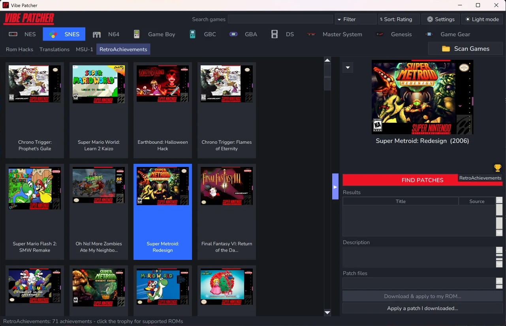
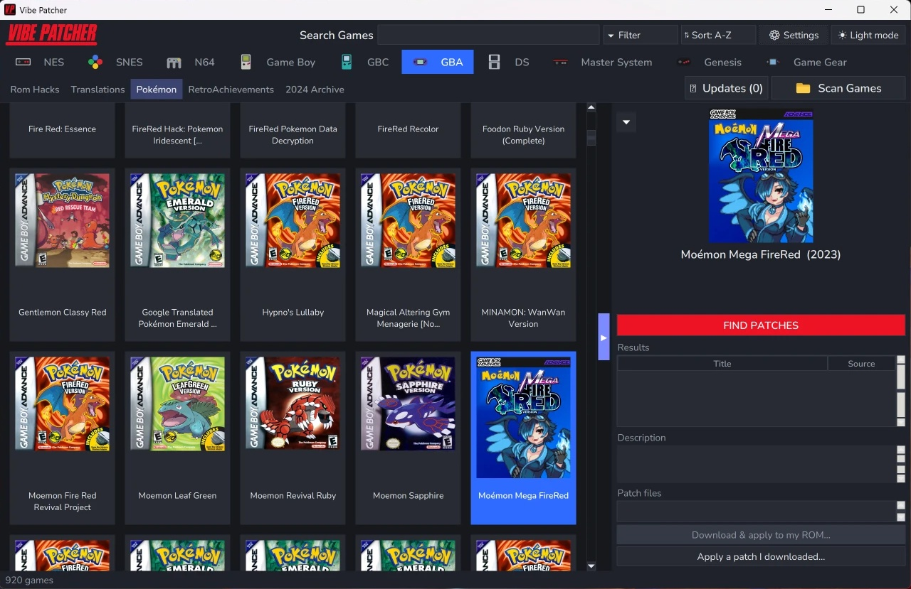
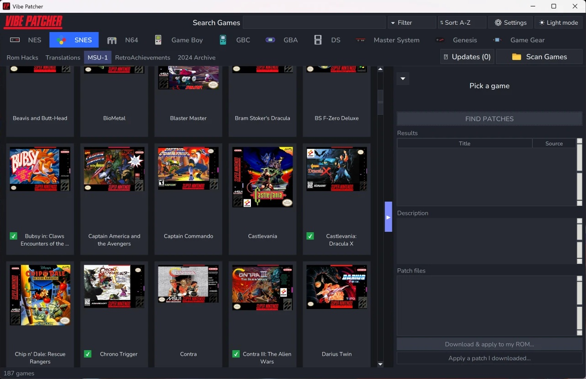

  

# Vibe Patcher

**Patch your classics. Play your way.**

Vibe Patcher is a Windows app for finding and applying ROM hacks, fan translations
and MSU-1 packs. Pick a game from its cover art, see what patches exist for it, and
patch your own ROM without hunting through forums or juggling separate patching tools.

Supported consoles: **NES, SNES, N64, Game Boy, Game Boy Color, Game Boy Advance, DS,
Master System, Genesis / Mega Drive and Game Gear.**

## What it does

- **Finds patches for you.** Hacks, translations and fixes are pulled together from
  several sources, including RetroAchievements' patch collection, GitHub,
  RomhackPlaza, Hackdex, PokéCommunity and a full archive of romhacking.net up to
  August 2024.
- **Patches in one click.** IPS, UPS, BPS and xdelta are all built in. Zips and
  other archives are unpacked automatically, and your original ROM is never touched.
- **Checks ROM compatibility.** Before you patch, Vibe Patcher checks whether your ROM
  is the version the hack was made for (region, revision and checksum) and warns you
  if it isn't, e.g. when a hack needs the US v1.1 ROM and you have the European one.
- **Scans your own ROMs.** Point it at your ROM folders and it marks the games you
  own. Turn on *Only Show Games I Own* and the library only shows those games and
  the hacks made for them.
- **Zips patched ROMs to save space**, if you turn the option on.
- **Handles MSU-1.** SNES games with CD-quality soundtracks get their own folder, and
  the music files are installed and renamed for you.
- **Has a section for Pokémon hacks**, on GBA, Game Boy, Game Boy Color and DS.
- **Shows RetroAchievements.** See which hacks have achievement sets and which patch
  versions they support.
- **Tracks updates.** Once a week it checks whether hacks you've patched have a newer
  version.
- **Dark and light themes.**

### Patches that need a browser

Some sites don't allow apps to download from them, so not every patch can be
downloaded inside Vibe Patcher. For those, it opens the page in your browser. Once
you download the patch there, Vibe Patcher picks the file up from your Downloads
folder and offers to patch it straight away.

### Optional accounts and keys

Everything works without an account, but adding these in *Settings > Accounts* gets
you more:

- **archive.org account (free):** unlocks the 2024 romhacking.net archive with
  downloads inside the app.
- **RetroAchievements Web API key (free):** turns on the RetroAchievements tab and
  achievement info.
- **GitHub token (free):** raises GitHub's search limits, so more patches are found.

Your keys stay on your PC, and your archive.org password is never saved.

## Screenshots

**Your library.** Pick a game to see its patches in the side panel.

**Pokémon hacks** have a tab of their own.

**MSU-1 packs** for SNES games.

## Getting started

1. Download `Vibe Patcher Portable.zip` from the
   [Releases](../../releases) page and unzip it anywhere.
2. Run `Vibe Patcher.exe`. Settings and downloads are kept in a `data` folder next to
   it, so the whole folder can be moved or copied.
3. On first start it suggests scanning your ROM folders. That's worth doing, so it can
   patch your games without asking which file to use.

## Bring your own ROMs

**Vibe Patcher does not include, distribute or download ROM files.** It only
downloads patches and applies them to ROMs you provide. Make sure you have the legal
right to use the ROMs and patches where you live.

## Known issues

- **Wrong patches in results.** Sometimes a patch for a different game, or a
  different hack, shows up in the results list. Matching patches to games across lots
  of sites with inconsistent naming is hard. It's being improved over time.

## Planned

- More languages for the app itself.
- Mac and Linux versions.

---

Made by [immaculatevibes2025](https://github.com/immaculatevibes2025), with help from
Claude.
